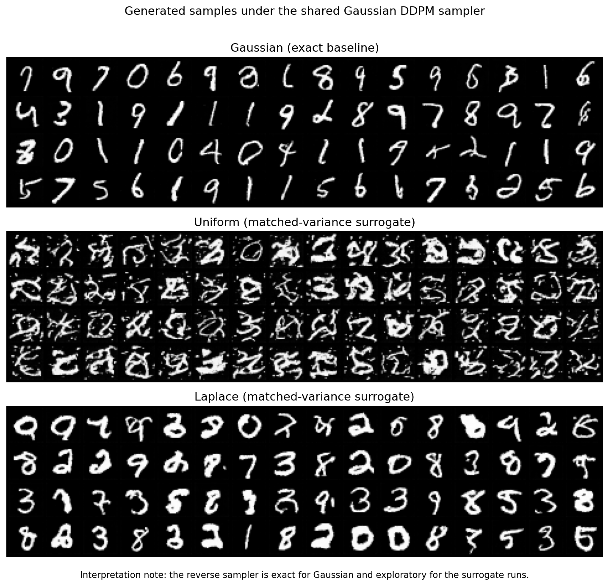
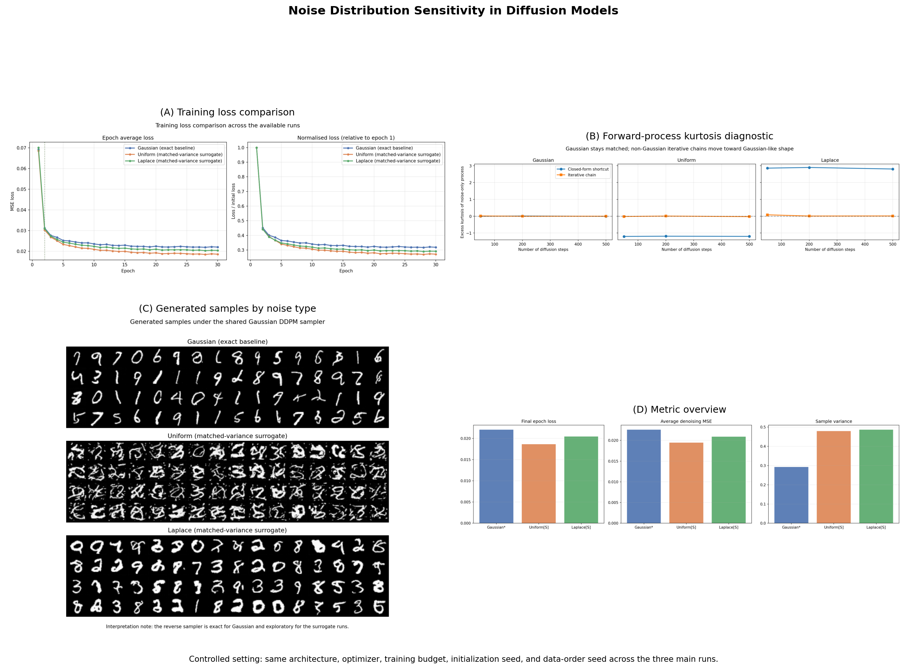
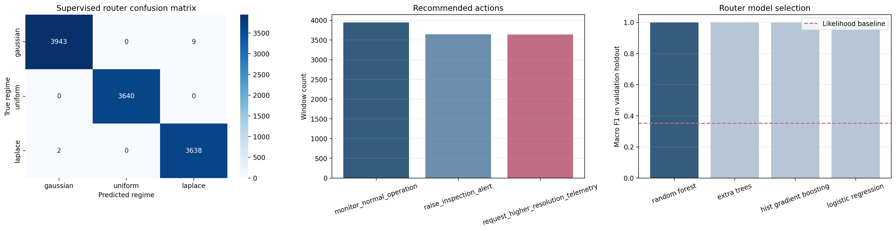

# Diffusion noise study and Battery Sentinel

Do diffusion models need Gaussian noise? Part 1 is a controlled DDPM experiment on MNIST: same data, U-Net, budget and schedule, only the law of the forward noise changes between Gaussian, uniform and Laplace. Part 2 reuses the three noise families as uncertainty regimes in Battery Sentinel, a battery-monitoring prototype that reads the shape of a residual to tell normal, quantised and impulsive telemetry apart.



## What it does

- Trains three DDPMs for 30 epochs each that differ only in the injected noise, and logs loss, denoising MSE per timestep, time and memory.
- Checks the forward process: with the closed-form shortcut the excess kurtosis of the noise stays at -1.2 (uniform) and +2.8 (Laplace) at every timestep, while an iterative chain reaches 0 within a few steps.
- Simulates 1 440 charging sessions of 128 steps, 480 per regime: Gaussian sensor noise, quantised telemetry, Laplace noise with current and temperature shocks.
- Reads the regime from the residuals of a twin trained on nominal sessions only: a likelihood-only router reaches macro-F1 0.351, a random forest on residual features 0.999 on 11 232 test windows.
- Maps each regime to an action: monitor, request higher-resolution telemetry, raise an inspection alert.

## How it works

```
MNIST 28x28 -> compact U-Net (6.54 M parameters, sinusoidal time embedding) -> predicts eps, MSE loss
  Gaussian = exact DDPM; uniform and Laplace only change the law of eps, at unit variance
battery simulator -> sessions split 70/15/15 -> 2-layer GRU twin on nominal windows (24 steps in)
  -> residual features -> random forest -> regime -> action
```

## Results

| metric | Gaussian | uniform | Laplace |
|---|---:|---:|---:|
| final epoch loss | 0.0220 | 0.0186 | 0.0205 |
| denoising MSE, test, 11 timesteps | 0.0226 | 0.0195 | 0.0209 |
| MSE at t=500 | 0.0134 | 0.0074 | 0.0109 |
| train time on a T4, peak GPU | 23.1 min, 2.28 GB | 22.5 min, 2.16 GB | 22.5 min, 2.16 GB |
| nearest-neighbour distance to real digits, CNN features | 11.7 | 14.7 | 13.5 |
| Battery Sentinel twin test RMSE | 0.108 | 0.119 | 0.244 |

Uniform has the lowest loss and denoising error at every timestep but the worst samples: Gaussian gives clean digits, Laplace thick ones, uniform noisy blobs. The three runs share the standard Gaussian reverse sampler, so only the Gaussian model is sampled with an update that matches its training law.




## Run it

Python 3.10 or later and Jupyter. Notebooks 1 to 6 need a GPU (about 70 minutes on a Colab T4 for the three trainings), 7 to 10 run on CPU in a few minutes.

```bash
pip install -r requirements.txt
jupyter lab notebooks/                                # 1-6 diffusion study, 7-10 Battery Sentinel
pip install -e .[eval]                                # audit CLI, works from the saved files
python -m research_extension.cli audit-training-dynamics
python -m research_extension.cli audit-saved-samples  # then audit-nearest-neighbors
python -m research_extension.cli app                  # Gradio explorer, needs .[app]
```

The notebooks mount Google Drive; elsewhere replace the `drive.mount` cell and set `PROJECT_DIR`. Checkpoints are not in the repository; Battery Sentinel can start at notebook 8 from the dataset in `battery_sentinel/data/`.

## Limitations

- The uniform and Laplace runs change the marginal noise law, not the chain, and are sampled with a mismatched sampler. A fair comparison needs a reverse process derived from each forward law.
- One seed and one run per family, no FID or IS, so loss differences of 0.002 have no error bars. A bounded noise is also an easier regression target.
- Battery Sentinel is simulated end to end and the router's features mirror the hard-coded quantisation steps, so its 0.999 macro-F1 is close to a sanity check. The next test would be a public cycling dataset such as NASA or CALCE.

Generative AI module project, CY Tech, ING3, 2025-2026, with Mouad Ouad and Amine Filali. Mouad and Amine wrote the setup and U-Net notebooks; I wrote the training campaign, the evaluation, the forward-process diagnostic, the audit tooling and all of Battery Sentinel.
