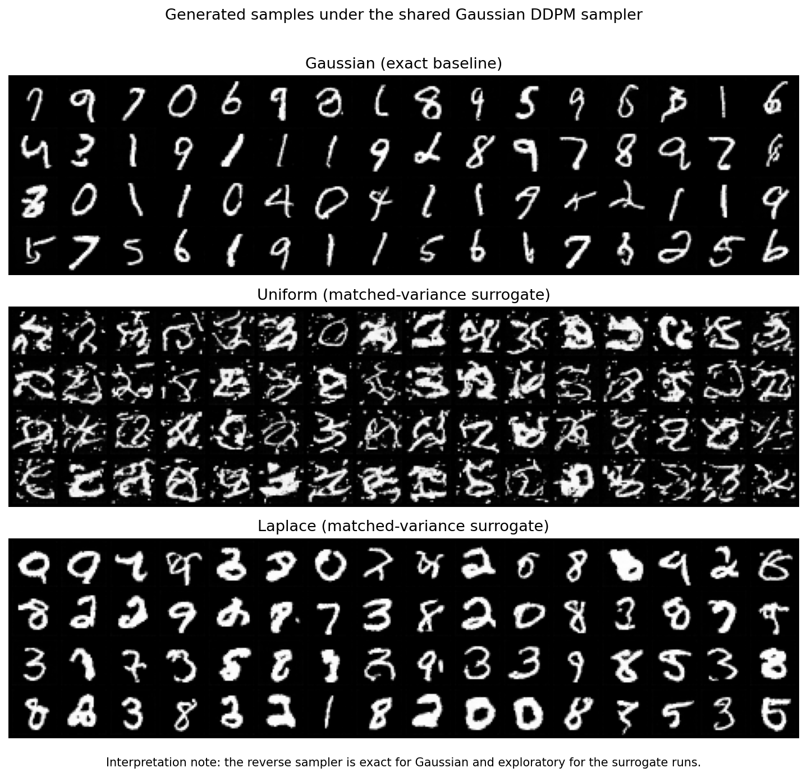
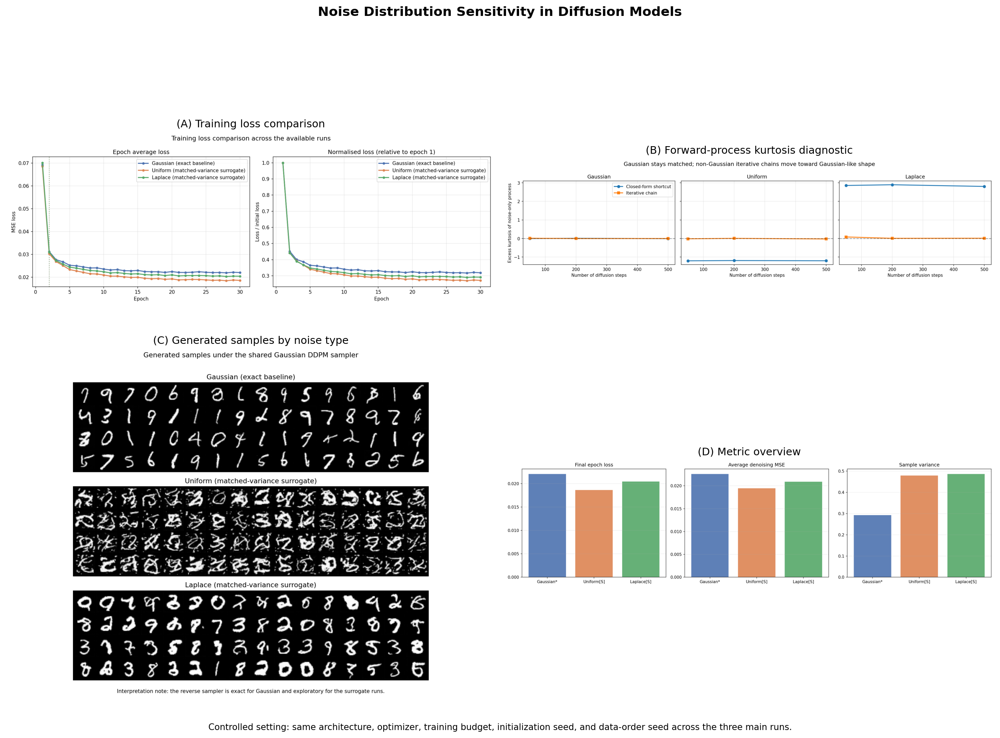
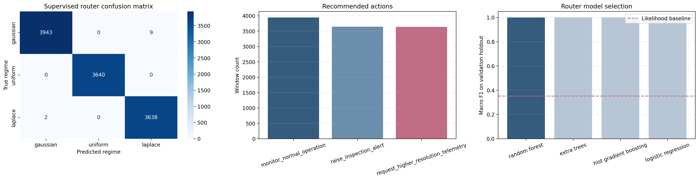

# Diffusion noise study and Battery Sentinel

Do diffusion models really need Gaussian noise? This repository is the project I did for the
Generative AI module at CY Tech (ING3, 2025-2026). It has two parts. The first is a controlled
experiment on MNIST: same data, same U-Net, same training budget and schedule, and only the noise
of the forward process changes (Gaussian, Uniform, Laplace). The second reuses the three noise
families as three "uncertainty regimes" in a small battery-monitoring prototype called Battery
Sentinel. The idea is that the distribution of a residual tells you something about what went
wrong: regular variation, quantised or low-resolution telemetry, or an impulsive event.

## Part 1: three noise families, one DDPM

Setup: MNIST (28x28), a compact U-Net with sinusoidal time embedding (6.54 M parameters,
channels 64/128/256), T = 1000 linear beta schedule (1e-4 to 0.02), 30 epochs, batch 256, AdamW
lr 2e-4, gradient clipping 1.0, mixed precision, seed 42 for both initialisation and data order.
The model predicts epsilon with an MSE loss. Gaussian noise is the exact DDPM baseline. For Uniform
and Laplace I keep the closed-form corruption `x_t = sqrt(a_t) x_0 + sqrt(1 - a_t) eps` and only
change the law of `eps`, standardised to zero mean and unit variance (`U(-sqrt(3), sqrt(3))`,
`Laplace(0, 1/sqrt(2))`). Each run took about 23 minutes on a Colab T4.

| Noise    | Final epoch loss | Mean denoising MSE (test, 11 timesteps) | MSE at t=500 | Train time | Peak GPU |
|----------|-----------------:|----------------------------------------:|-------------:|-----------:|---------:|
| Gaussian | 0.0220           | 0.0226                                  | 0.0134       | 23.1 min   | 2.28 GB  |
| Uniform  | 0.0186           | 0.0195                                  | 0.0074       | 22.5 min   | 2.16 GB  |
| Laplace  | 0.0205           | 0.0209                                  | 0.0109       | 22.5 min   | 2.16 GB  |

(Source: `diffusion_noise_project/logs/evaluation_summary.json` and the `*_loss.csv` files.)

On the numbers, Uniform wins: lowest loss, lowest denoising error at every timestep. On the
images, it loses. With the standard Gaussian reverse sampler applied to all three models, the
Gaussian run produces clean digits, Laplace produces plausible but thicker digits, and Uniform
produces noisy blobs. That gap between a denoising metric and generation quality is the main
result of part 1, and it has a simple explanation: the reverse update is derived for Gaussian
noise, so only the Gaussian run is evaluated with a sampler that matches its training law.
A bounded noise is also just an easier regression target, so a lower loss does not mean a
better generative model.



Notebook 2 contains a diagnostic I found useful: the excess kurtosis of the noise injected by the
closed-form shortcut stays at -1.2 (Uniform) and +2.8 (Laplace) at every timestep, while an
iterative chain with the same per-step noise goes to 0 after a few steps (central limit theorem).
So the Uniform and Laplace runs are "matched-variance surrogates" of a non-Gaussian diffusion,
not the real thing. The notebooks label them that way on purpose.



The `research_extension/` package adds a few audits computed from the saved outputs: a training
dynamics audit from the loss logs, and a sample audit that cuts the saved 8x8 grids into tiles and
scores them with a small MNIST CNN. Gaussian tiles are the closest to real MNIST in the CNN feature
space (mean nearest-neighbour distance 11.7, against 13.5 for Laplace and 14.7 for Uniform) and
cover all ten digits; the Uniform grid covers nine classes with the lowest classifier confidence
(0.73). The classifier is most confident on Laplace tiles (0.84 vs 0.78 for Gaussian), probably
because of their thick strokes, so I treat these audits as a rough check, not as a quality score.

## Part 2: Battery Sentinel

A simulator (notebook 7) generates 1440 charging sessions of 128 steps with four signals (SOC,
voltage, current, temperature), 480 per regime: Gaussian sensor noise (nominal), quantised
telemetry (Uniform regime) and Laplace noise plus injected current and temperature shocks (Laplace
regime). Sessions are split 70/15/15 (1007/217/216). A predictive twin (notebook 8), a 2-layer GRU
with 64 hidden units, reads a window of 24 observed steps and predicts the next SOC, voltage and
temperature. It is trained on nominal windows only (8840 windows, 12 epochs, about four seconds on the Colab GPU).
Its test RMSE grows with the regime: 0.108 (Gaussian), 0.119 (Uniform), 0.244 (Laplace), which
is what makes the residuals informative.

The router (notebook 9) turns residuals into a decision. I first tried a likelihood-only router
(Gaussian, Uniform and Laplace scores on the residual vector): macro-F1 0.351, barely above chance.
The supervised version builds 47 features from the residuals and the window (absolute differences,
distance to a quantisation grid, flat-segment ratio) and compares four classifiers on a 20 % holdout
of the validation windows (random forest 0.9996, extra trees 0.9996, gradient boosting 0.9991,
logistic regression 0.9973 macro-F1). The random forest, refit on the 11 284 validation windows and
evaluated on the 11 232 test windows, reaches accuracy 0.9990 and macro-F1 0.9990. Confusion matrix
(rows = true, columns = predicted, order Gaussian / Uniform / Laplace): 3943 / 0 / 9, 0 / 3640 / 0,
2 / 0 / 3638. Each regime maps to an action: `monitor_normal_operation`,
`request_higher_resolution_telemetry`, `raise_inspection_alert`.



A score this high mostly says the simulated regimes are separable by construction. See the
limitations below before reading it as a result.

## Repository layout

```
notebooks/                 01 setup, 02 forward process, 03 U-Net, 04 training, 05 evaluation,
                           06 write-up, 07 battery data, 08 twin, 09 router, 10 dashboard
diffusion_noise_project/   unet.py, config.json, logs/ (loss CSVs, run info, evaluation summary),
                           figures/, samples/ (final 8x8 grids per noise)
battery_sentinel/          data/ (simulated dataset, 4 MB), models/ (GRU twin), logs/ (router
                           metrics and predictions), figures/
research_extension/        audit CLI and optional Gradio explorer
research_extension_output/ saved audit results and figures
docs/                      slides presented on 12 May 2026
```

## How to run

```
pip install -r requirements.txt
jupyter lab notebooks/
```

Notebooks 1 to 6 were run on Google Colab (Tesla T4) and start by mounting Google Drive; to run
them elsewhere, replace the `drive.mount` cell and set `PROJECT_DIR`. Training the three models
takes about 70 minutes on a T4. The checkpoints (6 x 78 MB per run) are not in the repository;
the logs, figures and sample grids they produced are. Notebooks 7 to 10 run locally on CPU in a
few minutes, and since the simulated dataset is included you can start directly at notebook 8.

The audits work from the saved files and do not need the checkpoints:

```
pip install -e .[eval]
python -m research_extension.cli audit-training-dynamics
python -m research_extension.cli audit-saved-samples      # trains a small MNIST CNN once
python -m research_extension.cli audit-nearest-neighbors
python -m research_extension.cli app                      # Gradio explorer, needs .[app]
```

## Limitations and what I would do next

- The reverse sampler is the Gaussian DDPM update for all three runs. The Uniform and Laplace
  images are therefore generated under a mismatched sampler. A fair comparison needs a reverse
  process derived from each forward law, or a score-based formulation.
- The non-Gaussian runs change the marginal noise law, not the chain (see the kurtosis note).
- One seed and one run per family, no FID or IS. Differences of 0.002 in loss are not backed by
  error bars, and sample quality is judged visually plus a crude classifier audit.
- Battery Sentinel is simulated end to end. The quantisation steps and the shock injections are
  hard-coded in the simulator, and the router's grid-distance features use the same step sizes, so
  the 0.999 macro-F1 is close to a sanity check. The twin is also trained to predict the
  simulator's noise-free signal, which does not exist in a real system.
- Next steps: rerun part 1 with several seeds and FID, implement a Laplace reverse sampler, and
  test the twin plus router on a public battery dataset (NASA or CALCE cycling data) where the
  regimes are not known in advance.

## Context

Generative AI module, CY Tech ING3, April to May 2026, presented on 12 May 2026. Team: Haroun
Joudi, Mouad Ouad, Amine Filali. The first draft of the six diffusion notebooks came from the team
and the setup and U-Net notebooks are still that draft. I rewrote the training campaign and the
evaluation, added the forward-process diagnostic, ran the three training runs, and wrote the whole
Battery Sentinel part (notebooks 7 to 10), the `research_extension` package and this README.
The slides are in `docs/`.
